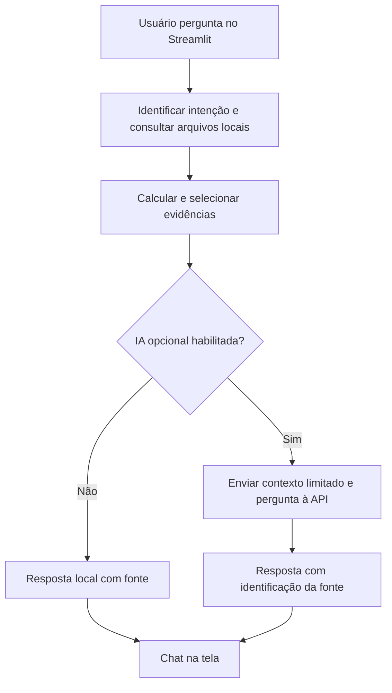

# 1. Documentação do agente

**Nome:** BIA Planeja. **Público:** aprendizes de finanças pessoais. **Problema:** informações de gastos e metas dispersas impedem o acompanhamento simples da organização financeira. **Solução:** diálogo em português com dados locais sintéticos, cálculos confiáveis e fontes explícitas.

**Persona:** educador amigável, objetivo, sem julgamentos ou promessas de ganhos. Quando não conhece a resposta, deixa claro que falta informação em vez de inventar.

## Arquitetura

**Anti-alucinação:** cálculos são feitos localmente, perguntas não cobertas recebem resposta de insuficiência, arquivos são citados. Modelo IA recebe contexto selecionado, mas o uso de modelo externo **não garante** ausência de alucinações. É necessária validação humana em decisões financeiras.

**Limites:** não prevê preços, não executa transações, não conecta bancos, não possui dados atuais e não recomenda investimentos individuais. O histórico de exemplo é de 2025; os prazos do perfil podem estar vencidos.
